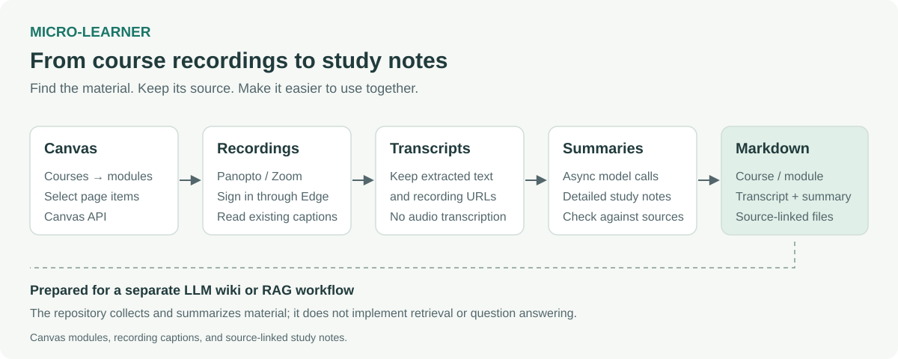

# micro-learner

micro-learner collects lecture transcripts from Canvas-linked recordings and turns them into organized Markdown notes. It navigates courses and modules, opens Panopto or Zoom recordings, extracts their captions, and uses an LLM to summarize the content.



*Diagram of the implemented workflow, not an application screenshot.*

## Motivation

Course material is spread across pages, recordings, slides, and links. Canvas helps organize the course, but using that material together in an LLM wiki or retrieval-augmented generation (RAG) workflow means first finding it and getting it into a useful form.

This project explores that first step. The goal is to navigate and manage multimodal course material without repeatedly opening each page and copying information by hand. The current implementation focuses on the text available in video captions. It keeps the source links and course structure alongside the extracted text and summaries, so the notes can be revisited or used in a separate wiki or retrieval system.

## What it does

1. Lists the courses available through the Canvas API.
2. Lets you select a course, modules, and Canvas Page items from the terminal.
3. Finds Panopto and Zoom links in page links and embedded recordings.
4. Opens the recordings in Microsoft Edge, where you complete any institutional sign-in.
5. Extracts captions and saves the transcripts with their recording URLs.
6. Generates a Markdown summary for each transcript and saves it under the same course and module.

The repository includes an existing [ensemble-learning transcript](data/courses/en-705-601-81-fa25-applied-machine-learning/module-6-ensemble-learning/transcript_en-705-601-81-fa25-applied-machine-learning_module-6-ensemble-learning_module-6-video-lectures.md) and its [generated study summary](data/courses/en-705-601-81-fa25-applied-machine-learning/module-6-ensemble-learning/summary_en-705-601-81-fa25-applied-machine-learning_module-6-ensemble-learning_module-6-video-lectures.md). These show the output format without requiring a Canvas account. The recording links themselves may require course access.

## How it works

- [canvas_navigator.py](canvas_navigator.py) handles paginated Canvas requests, course/module selection, media-link discovery, and file organization.
- [panopto_transcript_scraper.py](panopto_transcript_scraper.py) and [zoom_transcript_scraper.py](zoom_transcript_scraper.py) use Playwright with a persistent Edge profile to read rendered captions after sign-in.
- [llm.py](llm.py) sends asynchronous summarization requests through an OpenAI-compatible endpoint. The Canvas workflow preserves the order of transcripts and their summaries.

Output is written below `data/courses/<course>/<module>/`. Each selected page gets a `transcript_*.md` file and, when transcripts are available, a `summary_*.md` file. Both retain the recording URLs as section headings.

The current workflow prepares existing video captions for a separate wiki or retrieval system. Generated summaries are a starting point for study, with the transcript and source recording available for checking details.

## Quick start

Use Python 3.10 or newer and Microsoft Edge. The scripts use Playwright's `msedge` channel rather than its bundled Chromium browser.

```sh
git clone https://github.com/TheDeafOne/micro-learner.git
cd micro-learner
python -m venv .venv
```

Activate the environment with `source .venv/bin/activate` on macOS/Linux, or `.venv\Scripts\Activate.ps1` in Windows PowerShell. Install the imported packages:

```sh
python -m pip install requests beautifulsoup4 python-dotenv openai tqdm playwright
```

Install [Microsoft Edge](https://www.microsoft.com/edge) if it is not already available. Playwright can also install the browser with `python -m playwright install msedge`.

### Configuration

Copy [.env.example](.env.example) to `.env` and fill in:

| Setting | Purpose |
| --- | --- |
| `CANVAS_BASE_URL` | Your Canvas origin, such as `https://your-school.instructure.com`, without `/api/v1` |
| `CANVAS_TOKEN` | A Canvas access token for the courses you want to read |
| `PORTKEY_AI_BASE_URL` | The OpenAI-compatible endpoint used for summaries |
| `PORTKEY_AI_API_KEY` | The API key accepted by that endpoint |

The model is currently set to `gpt-5-mini` in [llm.py](llm.py); the configured endpoint needs to support that model name. Change the value there if your endpoint uses another model. Transcript collection uses the Canvas token, while recording access uses the separate browser sign-in.

### Run

```sh
python canvas_navigator.py
```

Choose a course, then select modules and pages by number. Multiple selections accept entries such as `1,3-5`; `a` selects all and `q` quits.

When Edge opens, complete the recording provider's sign-in and leave the browser open while captions are collected. The local `edge-profile/` directory keeps the browser session between runs. The script prints the paths of the saved transcript and summary files. Run it from the repository root so the profile and output paths remain consistent.

To extract a transcript directly, without the Canvas selection or summary step:

```sh
python panopto_transcript_scraper.py "https://your-host.panopto.com/Panopto/Pages/Viewer.aspx?id=RECORDING_ID"
python zoom_transcript_scraper.py "https://your-host.zoom.us/rec/play/RECORDING_ID"
```

These commands print the transcript. Access and caption availability depend on the recording, and the browser selectors may need updating when the provider changes its interface.
